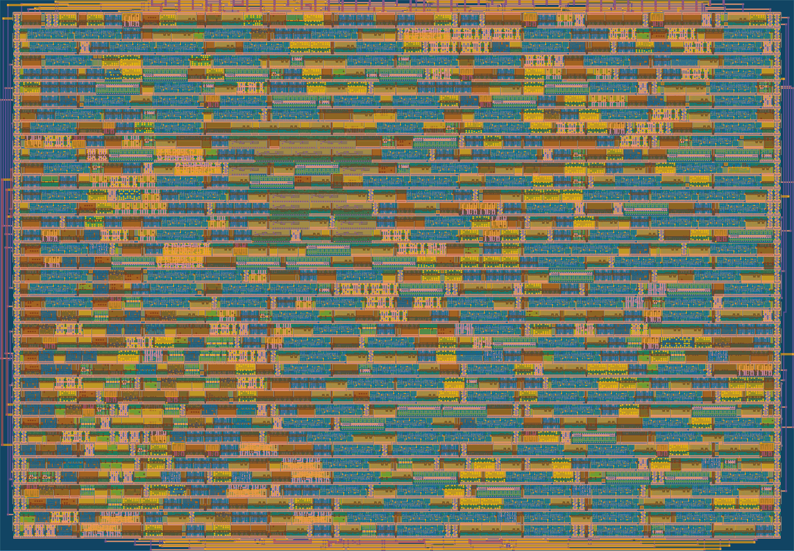
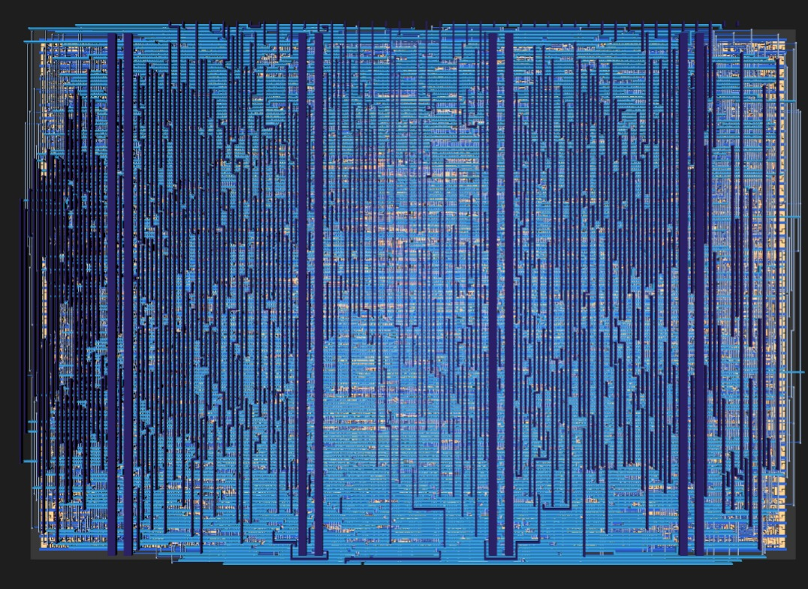
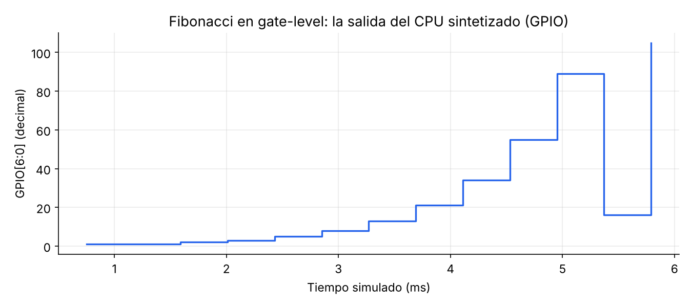
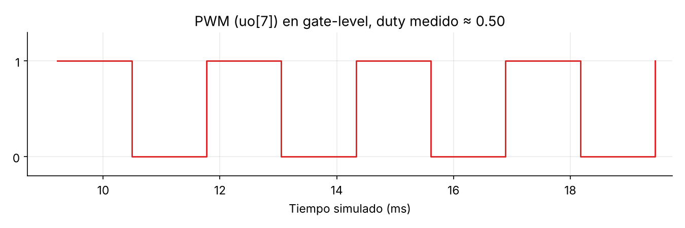

# Zenith-Core v1 — 1x1 tile (TTSKY26d)

CPU Zenith + PWM en un tile. La memoria de programa y datos la sirve el RP2040 de la placa de demo, en modo lockstep:
el RP2040 genera el reloj, avanza un ciclo y lee el bus de observación `uio` (VIEW), manejando `ui_in` con la instrucción o el dato.

## Estadísticas

### Routing stats

| Utilisation (%) | Wire length (um) |
|---|---|
| 82.047 % | 69533 |

### Cell usage by Category

| Category | Cells | Count |
|---|---|---|
| Fill | decap fill | 440 |
| Tap | tapvpwrvgnd | 225 |
| Multiplexer | mux2 mux4 | 156 |
| Flip Flops | dfrtp dfxtp dfstp | 185 |
| Misc | dlygate4sd3 conb | 155 |
| Combo Logic | a2111o a2111oi a211o a211oi a21bo a21o a21oi a221o a221oi a22o a22oi a2bb2o a311o a311oi a31o a32o o211a o21a o21ai o21bai o221a o22a o2bb2a o31a o31ai o32a | 265 |
| Clock | clkdlybuf4s25 | 63 |
| Buffer | buf clkbuf | 87 |
| NOR | xnor2 nor2 nor3 nor3b | 64 |
| AND | and3 and2 and2b and3b and4b and4bb | 77 |
| NAND | nand2 nand2b nand3 | 44 |
| OR | or2 or3 or4 xor2 or3b or4b | 60 |
| Inverter | inv | 26 |
| Diode | diode | 39 |

**1221 celdas en total (sin fill ni tap).**

### Precheck (15/15)

| Check | Resultado |
|---|---|
| Magic DRC | ✅ |
| KLayout FEOL | ✅ |
| KLayout BEOL | ✅ |
| KLayout offgrid | ✅ |
| KLayout pin label overlapping drawing | ✅ |
| KLayout zero area | ✅ |
| KLayout Checks | ✅ |
| Pin check | ✅ |
| Boundary check | ✅ |
| Power pin check | ✅ |
| Layer check | ✅ |
| Cell name check | ✅ |
| urpm/nwell check | ✅ |
| Analog pin check | ✅ |
| Verilog syntax check | ✅ |

### Timing, potencia y verificación física

Reloj de síntesis: 20 ns (50 MHz).

| Métrica | Valor |
|---|---|
| Setup WNS, tt 25C 1.8V | +12.12 ns (Fmax ≈ 126 MHz) |
| Setup WNS, peor corner (ss 100C 1.6V) | +6.26 ns (Fmax ≈ 73 MHz) |
| Hold WNS, peor corner (ff -40C 1.95V) | +0.126 ns |
| Violaciones setup / hold | 0 / 0 |
| Max cap / max slew (suma de corners) | 3 / 465 (en tt: 0 / 67) |
| Potencia total (STA, 50 MHz) | ≈ 0.9 mW (reloj 57 %, secuencial 42 %, combinacional 1.4 %) |
| IR drop peor caso | 0.078 mV (0.00 %) |
| Antenna / LVS / DRC | Passed |

Fmax = 1 / (20 ns − slack), estimado con el slack de setup; no es una medición en silicio.

## Layout

### 3D (TinyTapeout GDS viewer)

## Simulación gate-level (3/3 tests)

Netlist post-síntesis, cocotb. Tests: Fibonacci, STORE/LOAD, PWM.

GPIO = 1, 2, 3, 5, 8, 13, 21, 34, 55, 89. Los dos últimos valores (144, 233) aparecen como 16 y 105 porque el GPIO de este chip es de 7 bits (144 mod 128 = 16, 233 mod 128 = 105).

Periodo 2.56 ms, alto 1.28 ms → duty 0.50. Los tiempos son del reloj del modelo de prueba (el chip no tiene frecuencia fija).
