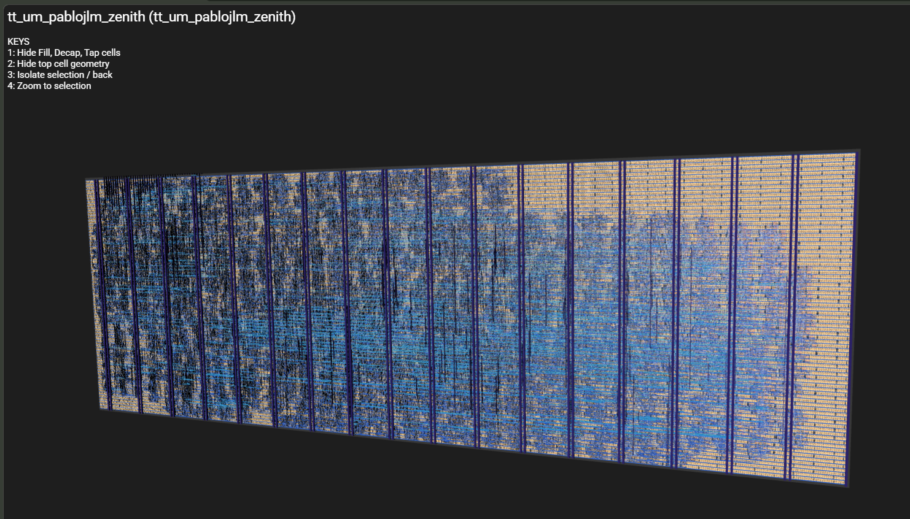
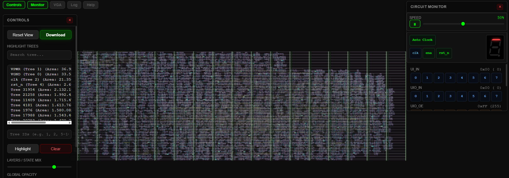
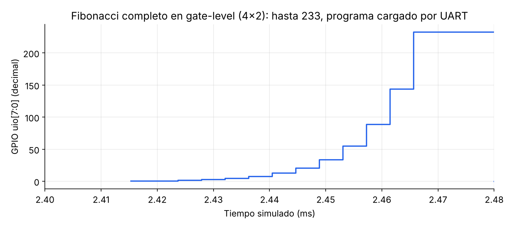
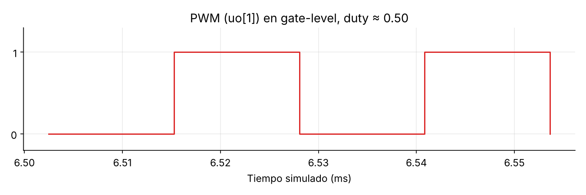
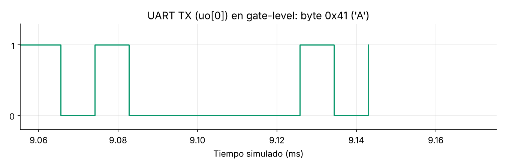

# Zenith-Core v2 — 4x2 tiles 

Micro autónomo: CPU + memoria de programa (64 x 16 bit) + RAM (16 B) + loader UART + UART TX + PWM + GPIO de 8 bits.
El programa se carga por UART (115200 baud, reloj 10 MHz). El CPU no arranca hasta la primera carga.

## Pines

| Pin | Función |
|---|---|
| ui[0] | UART RX (loader) |
| uo[0] | UART TX |
| uo[1] | PWM |
| uo[2] | Cargando |
| uo[7:3] | PC[4:0] |
| uio[7:0] | GPIO (con registro de dirección) |

## Estadísticas

### Routing stats

| Utilisation (%) | Wire length (um) |
|---|---|
| 51.638 % | 236751 |

### Cell usage by Category

| Category | Cells | Count |
|---|---|---|
| Fill | decap fill | 16323 |
| Tap | tapvpwrvgnd | 2158 |
| Multiplexer | mux2 mux4 | 1639 |
| Flip Flops | dfrtp dfxtp dfstp | 1506 |
| Misc | dlygate4sd3 | 1422 |
| Combo Logic | a21oi o211a a221o o221a a21o a22o o22a or4bb or4b or3b and4b and4bb a31o a311o and3b o21a o21ai a211o nand3b a2bb2o o221ai o2bb2a and2b o21ba a32o o31ai nor3b o2111ai a22oi o31a o32a o2111a a21bo a221oi a311oi o22ai a211oi o311a a2111o nor4b | 947 |
| Clock | clkinv clkinvlp clkdlybuf4s25 | 570 |
| Buffer | buf clkbuf bufinv | 411 |
| NOR | xnor2 nor2 nor3 nor4 | 131 |
| AND | and3 and2 and4 a21boi | 118 |
| NAND | nand2 nand2b nand3 | 112 |
| OR | or2 or3 or4 xor2 | 110 |
| Inverter | inv | 50 |
| Diode | diode | 31 |

**7047 celdas en total (sin fill ni tap).**

### Precheck (15/15)

| Check | Resultado |
|---|---|
| Magic DRC | ✅ |
| KLayout FEOL | ✅ |
| KLayout BEOL | ✅ |
| KLayout offgrid | ✅ |
| KLayout pin label overlapping drawing | ✅ |
| KLayout zero area | ✅ |
| KLayout Checks | ✅ |
| Pin check | ✅ |
| Boundary check | ✅ |
| Power pin check | ✅ |
| Layer check | ✅ |
| Cell name check | ✅ |
| urpm/nwell check | ✅ |
| Analog pin check | ✅ |
| Verilog syntax check | ✅ |

## Layout

### 3D (TinyTapeout GDS viewer)

<!-- Pega aquí la foto del 3D: guárdala como 3d_4x2.png -->

### GDS explorer

## Simulación gate-level (4/4 tests)

Netlist post-síntesis, cocotb. Tests: Fibonacci con carga por UART, STORE/LOAD, PWM, UART TX.

Fibonacci cargado por UART: `uio` muestra 1, 2, 3, 5, 8, 13, 21, 34, 55, 89, 144, 233 (8 bits completos).

Periodo 25.6 µs, alto 12.8 µs → duty 0.50.

Byte 0x41 ('A') transmitido por `uo[0]`.

## Notas

- Se corrigió un bug de LOAD (la lectura de RAM devolvía el dato viejo) con lectura combinacional en `data_memory.v`.
- Se agregó `prog_loaded`: el CPU espera la primera carga, porque en silicio la memoria de programa arranca con valores Indeterminados xd
